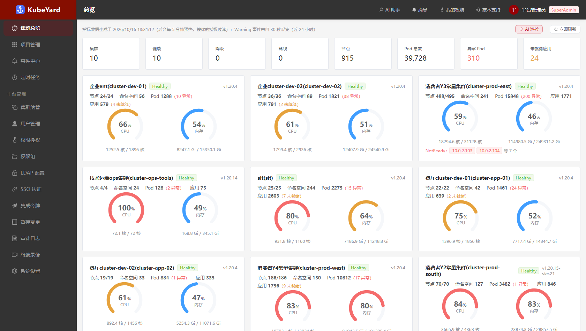
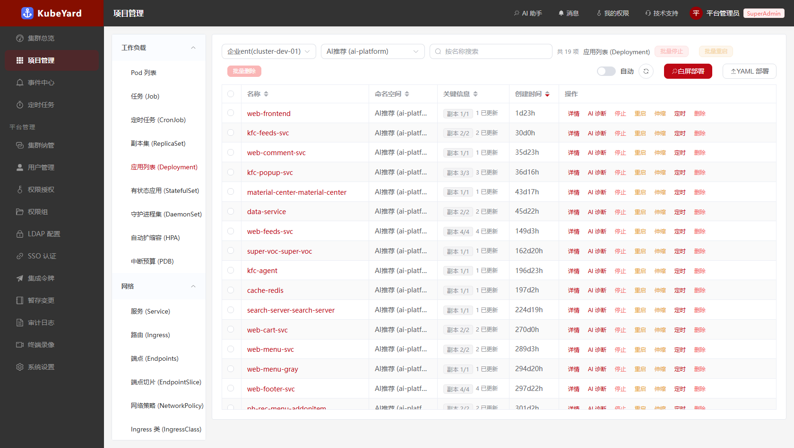
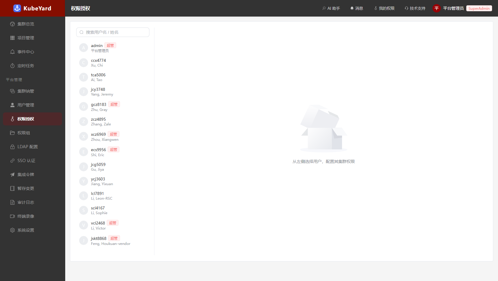
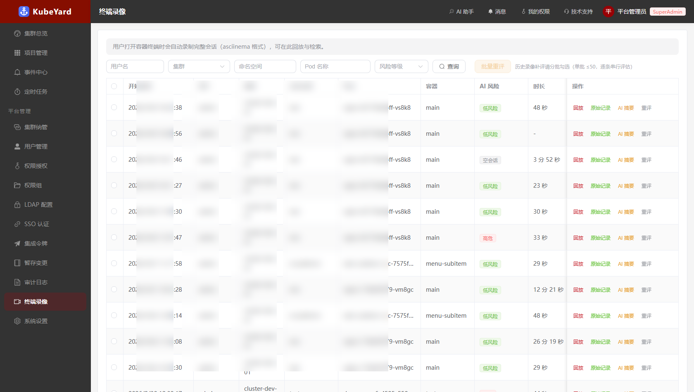
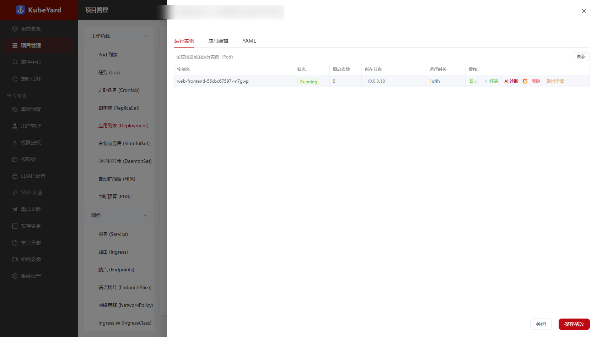
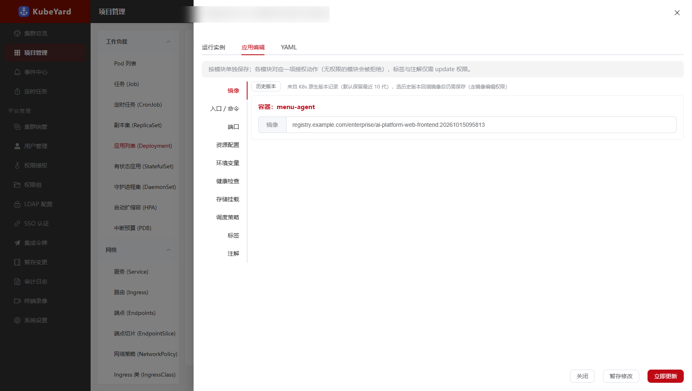
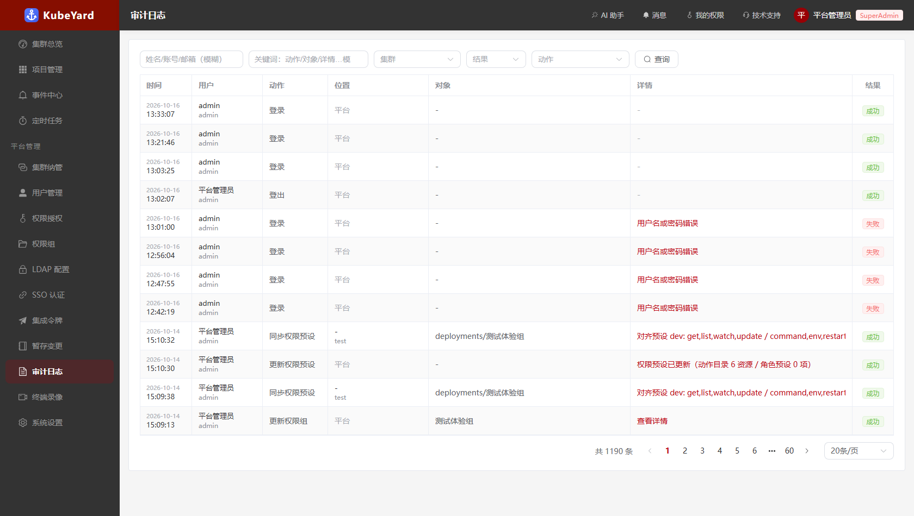

# KubeYard · 企业级 Kubernetes 多集群管理平台

<p align="center">
  
</p>

**English** | [中文](#中文说明)

KubeYard is a self-hosted, web-based Kubernetes multi-cluster management platform built for real operations teams — multi-tenant RBAC with field-level authorization, guided no-YAML deployments, full-lifecycle terminal auditing with AI risk assessment, and an AI assistant across every operational surface.

> Born out of a production environment managing **10+ clusters / 900+ nodes / 40,000+ pods**. Every feature below is battle-tested against real workloads, not toy clusters.

---

## Highlights

### 🖥 Multi-cluster, one pane of glass
Register unlimited clusters via kubeconfig; unified inventory across clusters with per-cluster health, capacity and abnormal-pod roll-ups; cluster failover with identity fingerprinting (prevents silently connecting to the wrong cluster via stale kubeconfigs).


### 🚀 Guided no-YAML deployment
Deployments / StatefulSets / Jobs / CronJobs through a progressive form: containers, resource quotas, probes, storage mounts, scheduling (nodeSelector / affinity / anti-affinity), services — with live YAML preview. YAML editing stays first-class (Monaco) for everything else.



### 🔐 Field-level RBAC, not just verb-level
Grants go beyond `get/update/delete`: per-module action tokens (image, env, probes, storage, scheduling…) mapped to YAML field paths. A user may edit a Deployment's image but be denied its env vars — enforced server-side via deep diff, not just hidden in UI. Role presets, permission groups, grant expiry, and a new Profile/Binding authorization engine rolling out behind a shadow-mode flag.



### ⌨️ Terminals with a complete audit chain
In-browser terminals (xterm.js) with full session recording (asciinema), playback, dangerous-command interception (rm -rf /, mkfs… are blocked before execution), and **automatic AI risk assessment** of every session — low/medium/high with reasons, so auditors filter for high-risk sessions instead of reading hours of logs.



### 🤖 AI woven through operations (strictly read-only)
Diagnose a pod (status + logs + events as context), explain/review/generate YAML, chat-based troubleshooting, cluster inspection — every AI surface is read-only by design. Works with OpenAI-compatible / Anthropic / Azure endpoints.

### 📋 And everything else you'd expect
Event center, scheduled restarts/scaling, pod file browser & upload, live logs with streaming, ConfigMap/Secret/PVC/Service/Ingress forms, draft-and-apply workflow for form edits, audit log with fuzzy search, SSO (OAuth2) + LDAP, Grafana deep links, Chinese/English-friendly UI.

---

## Screenshots

| | |
|---|---|
|  |  |
| *Unified resource browsing* | *Application detail & in-place editing* |
|  |  |
| *Module-based form editing* | *Audit log* |
|  |  |
| *Terminal recordings with AI risk levels* | *Authorization management* |

## Architecture

```
┌────────────┐  ┌────────────┐  ┌────────────┐
│  Vue 3 SPA │  │  Go API    │  │  WebSocket │
│ Element+   │←→│  (Gin)     │←→│  exec/logs │
│ Monaco     │  │            │  │            │
└────────────┘  └─────┬──────┘  └─────┬──────┘
                      │  client-go (dynamic + typed)
                ┌─────┴─────────────────────┐
                │  N × Kubernetes clusters  │
                └───────────────────────────┘
                      │
                ┌─────┴──────┐
                │ MySQL      │  users / grants / audit /
                │ (GORM)     │  recordings / events / settings
                └────────────┘
```

- **Backend**: Go (Gin + client-go). All cluster access is proxied server-side — kubeconfigs never reach the browser. Field-level authorization is enforced by deep-diffing every write against grant patterns before it hits the API server.
- **Frontend**: Vue 3 + Element Plus + Monaco. Per-module form editing, YAML everywhere, virtualized log viewer.
- **Auth**: local accounts + LDAP + OAuth2 SSO; JWT with revocation list; forced re-login on permission changes.
- **Recording**: terminal I/O tee'd into asciicast v2, stored in MySQL, auto risk-assessed by LLM on session end.

## Quick start

### Docker Compose (includes MySQL)

```bash
git clone https://github.com/<you>/kubeyard.git
cd kubeyard
cp .env.example .env        # set MYSQL_ROOT_PASSWORD / MYSQL_DB_PASSWORD
docker compose up -d
# open http://localhost:8000 — initial admin password is printed once in the logs:
docker compose logs kubeyard | grep "初始密码"
```

### From source

```bash
# backend (Go 1.22+, MySQL required)
cd server
cp config.yaml.example config.yaml   # point to your MySQL
go run main.go

# frontend (Node 18+)
cd web
npm install
npm run build       # served by the Go binary at :8000
```

On first start an `admin` account is seeded and a one-time random password is printed to the log.

### Configuration

| Env | Purpose |
|---|---|
| `KUBEYARD_DB_HOST/PORT/USER/PASSWORD/NAME` | MySQL connection |
| `KUBEYARD_JWT_KEY` / `KUBEYARD_ENCRYPTION_KEY` | Optional: explicit keys (auto-generated & persisted otherwise) |
| `KUBEYARD_AUTHZ_ENGINE` | `legacy` / `shadow` / `enforce` — new authorization engine rollout flag (default `shadow`) |
| `KUBEYARD_DATA_DIR` | recordings fallback storage (default `./data`) |

## Testing

```bash
cd server && go test ./...      # unit tests: auth, authz, middleware, ws, api
cd web && npm test              # component tests: scheduling editor data flow
```

## Security model

- Cluster credentials stored server-side; the browser never sees a kubeconfig.
- Every write is deep-diffed against the caller's grant patterns; unauthorized field changes are rejected with the exact offending paths listed.
- Terminal sessions are recorded by default (with an on-screen indicator), dangerous commands are intercepted pre-execution, and sessions are AI risk-rated.
- JWTs are revoked on permission changes; a revocation GC keeps the denylist bounded.

## License

MIT

---

<a id="中文说明"></a>

# KubeYard · 企业级 Kubernetes 多集群管理平台

面向真实运维团队的自托管 Web 端 Kubernetes 多集群管理平台：多租户 RBAC 与**字段级授权**、免 YAML 的向导式部署、覆盖全生命周期的**终端审计与 AI 风险评估**、贯穿各功能面的 AI 助手（严格只读）。

> 诞生于管理 **10+ 集群 / 900+ 节点 / 4 万+ Pod** 的生产环境，以下所有特性都在真实工作负载下长期验证。


## 核心特性

- **多集群统一纳管**：kubeconfig 导入无限集群；跨集群统一资源视图，按集群聚合健康度/容量/异常 Pod；集群故障切换带身份指纹核验（防止 kubeconfig 陈旧导致连错集群）
- **白屏部署与应用编辑**：Deployment/StatefulSet/Job/CronJob 渐进式表单（容器/资源配额/探针/存储挂载/调度策略/Service），YAML 实时预览；Monaco YAML 编辑保留为一等公民
- **字段级 RBAC**：授权不止 `get/update/delete`——按模块动作令牌（镜像/环境变量/探针/存储/调度策略…）映射到 YAML 字段路径，服务端深 diff 强制执行（改了未授权字段整单拒绝并列出越权路径）；角色预设 / 权限组 / 授权到期 / 新版 Profile+Binding 授权引擎（shadow 模式灰度中）
- **终端全链路审计**：浏览器终端（xterm.js）+ 全量会话录像（asciinema）+ 回放 + 高危命令拦截（`rm -rf /`、`mkfs` 等执行前拦截）+ **AI 自动风险评级**（low/medium/high + 理由，审计员按等级筛高危会话）
- **AI 助手（严格只读）**：Pod 诊断（状态+日志+事件作上下文）/ YAML 解释·审查·生成 / 排查对话 / 集群巡检；兼容 OpenAI / Anthropic / Azure 协议
- **应有尽有的其余功能**：事件中心、定时重启/扩缩容、Pod 文件浏览与上传、流式日志、ConfigMap/Secret/PVC/Service/Ingress 表单、表单暂存-应用工作流、审计模糊检索、SSO（OAuth2）+ LDAP、Grafana 深链

## 截图

见上方英文区截图墙（`docs/screenshots/`）。

## 快速开始

```bash
git clone https://github.com/<you>/kubeyard.git
cd kubeyard
cp .env.example .env        # 设置 MYSQL_ROOT_PASSWORD / MYSQL_DB_PASSWORD
docker compose up -d
# 打开 http://localhost:8000 — 初始 admin 密码仅在日志打印一次：
docker compose logs kubeyard | grep "初始密码"
```

源码运行与配置项见上方英文区；配置支持环境变量覆盖（数据库 / JWT 与加密密钥 / 权限引擎模式 / 录像目录）。

## 安全模型

- 集群凭据仅存服务端，浏览器永远接触不到 kubeconfig
- 所有写操作与授权模式深 diff，未授权字段变更整单拒绝并明确列出越权路径
- 终端默认录制（界面常驻震慑标识）、高危命令执行前拦截、会话 AI 风险评级
- 权限变更即吊销 JWT；吊销表定时 GC

## License

MIT
